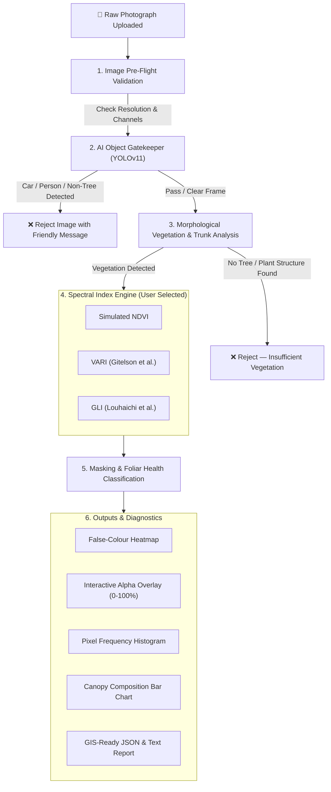

# 🌳 Urban Tree Health Monitor

[](https://python.org)
[](https://streamlit.io)
[](https://ultralytics.com)
[](LICENSE)
[](tests/)

An advanced computer-vision and spectral index platform for evaluating urban forest vitality, canopy density, and foliar stress from standard high-resolution photography.

---

## 🎯 Key Features

- **Multi-Index Spectral Analysis**:
  - **Simulated NDVI**: Near-Infrared simulation from RGB color spaces.
  - **VARI (Visible Atmospherically Resistant Index)**: Peer-reviewed index (*Gitelson et al., 2002*) designed specifically for RGB sensors to estimate green vegetation fraction while reducing atmospheric variability.
  - **GLI (Green Leaf Index)**: Peer-reviewed index (*Louhaichi et al., 2001*) that isolates active foliage from bare soil, dead wood, and urban backgrounds.
- **AI Gatekeeper (YOLOv11-nano)**:
  - Deep learning object detector automatically identifies and rejects non-target photos (vehicles, pedestrians, urban infrastructure).
  - Gracefully falls back to computer-vision morphological analysis if deep-learning weights are offline.
- **Multi-Stage Morphological Vegetation Detector**:
  - Detects green leaves, autumn foliage, bare winter branches, and vertical trunk structures.
- **Interactive Heatmap Overlay**:
  - Adjustable alpha transparency slider (0% to 100%) blends false-colour spectral heatmaps directly over the real tree photograph, allowing arborists to inspect exactly which branches or canopy regions are stressed.
- **Comparative & Seasonal Analysis**:
  - Upload baseline and current images side-by-side to track canopy recovery, seasonal senescence, or post-treatment vigor deltas ($\Delta$).
- **Report & Data Export**:
  - One-click export of structured **JSON Assessment Reports** (for GIS / arborist inventories) and formatted **Text Summaries**.
- **Automated Pytest Suite**:
  - Comprehensive unit tests covering vegetation masking, index calculations, and report generation.

---

## 🔬 How It Works (End-to-End Pipeline)

The system transforms raw RGB photographs into actionable arborist diagnostics through a multi-stage computer vision pipeline:



### Detailed Pipeline Breakdown:

1. **Pre-Flight Validation (`utils/vegetation.py`)**:
   - Ensures the file is a valid 3-channel RGB image with resolution $\ge 100 \times 100$ pixels.
2. **AI Gatekeeper (`utils/detection.py`)**:
   - Runs inference using Ultralytics YOLOv11-nano.
   - Rejects images dominated by urban clutter (e.g., cars, motorcycles, pedestrians, airplanes, traffic lights).
   - If YOLO weights are missing, the system gracefully logs a diagnostic and falls back to colour-space analysis.
3. **Morphological Vegetation & Trunk Detector (`utils/vegetation.py`)**:
   - **Green Foliage**: Evaluates HSV colour space ($H \in [25, 95]$) for active leaf chlorophyll.
   - **Brown / Autumn Foliage & Branches**: Evaluates brown tones ($H \in [0, 35]$) with $3 \times 3$ morphological opening and closing kernels.
   - **Branch Complexity**: Uses Canny edge detection ($50, 150$) to evaluate branch branching density.
   - **Vertical Trunk Kernel**: Applies a directional rectangular kernel ($3 \times 25$ px) to identify vertical trunk and stem structures.
4. **Spectral Index Calculation (`utils/indices.py` & `utils/ndvi.py`)**:
   - Computes the selected index across every pixel:
     - **Simulated NDVI**: Estimates NIR reflectance via green dominance and material masking.
     - **VARI**: $(G - R) / (G + R - B + \epsilon)$
     - **GLI**: $(2G - R - B) / (2G + R + B + \epsilon)$
5. **Vegetation Masking & Diagnostic Classification**:
   - Non-vegetation background (sky, concrete, walls) is masked out.
   - Mean index values are evaluated against calibrated thresholds:
     - 🌿 **Healthy** ($> 0.10$): High chlorophyll density, robust canopy.
     - 🌾 **Moderate** ($-0.10$ to $0.10$): Thinning canopy, slight abiotic or moisture stress.
     - 🍂 **Stressed** ($\le -0.10$): Severe foliar chlorosis, defoliation, or disease.
     - 🏜️ **No Vegetation** ($< 5\%$ coverage): Insufficient plant tissue in frame.
6. **Visualization & Blended Overlay (`utils/visualization.py`)**:
   - Applies false-colour colormaps (`JET`, `TURBO`, `VIRIDIS`, `SUMMER`).
   - Blends heatmap directly onto the photographic image via alpha transparency:
     $$\text{Blended} = \alpha \cdot \text{Heatmap} + (1 - \alpha) \cdot \text{Original}$$
7. **Report Generation (`utils/export.py`)**:
   - Generates structured JSON reports with image dimensions, statistical distribution, canopy breakdown, and automated horticultural recommendations.

---

## 📊 Scientific Remote Sensing Indices

| Index | Formula | Physical Interpretation | Best Use Case | Reference |
|---|---|---|---|---|
| **VARI** | $\frac{G - R}{G + R - B}$ | Minimizes atmospheric variability and solar irradiance effects | RGB cameras & drones under natural sunlight | *Gitelson et al. (2002)* |
| **GLI** | $\frac{2G - R - B}{2G + R + B}$ | Isolates photosynthetic leaf tissue from background soil & bark | Mixed canopies with visible ground or mulch | *Louhaichi et al. (2001)* |
| **Simulated NDVI** | $\frac{\text{NIR}_{\text{sim}} - R}{\text{NIR}_{\text{sim}} + R}$ | Approximation of classic multispectral NIR scattering | General green canopy vigor comparisons | Multi-stage heuristic approximation |

---

## 🖥️ User Interface Overview (3 Specialized Tabs)

### Tab 1: Single Tree Health Assessment
- Drag-and-drop image uploader supporting JPG, PNG, and WebP.
- 3-column side-by-side inspection: **Original Photo**, **Spectral Heatmap**, and **Canopy Overlay**.
- Interactive **Overlay Opacity Slider** ($0\% \to 100\%$) to pinpoint exact branches experiencing stress.
- Diagnostic Summary Banner & 4 Key Metric Cards (Status, Mean Index, Canopy Coverage %, Uniformity).
- Foliar Health Composition breakdown (Healthy %, Moderate %, Stressed %).
- High-resolution Matplotlib distribution histogram and health breakdown bar chart.
- One-click **JSON Report** and **Text Summary** download buttons.

### Tab 2: Comparative & Seasonal Analysis
- Side-by-side multi-temporal comparison of two images:
  - **Image A (Baseline)**: Prior season, spring baseline, or pre-treatment.
  - **Image B (Current)**: Post-treatment, drought period, or current condition.
- Computes automatic delta metrics ($\Delta$ Mean Index, $\Delta$ Coverage %, $\Delta$ Health shift) and provides an automated directional trend assessment (Improved, Degraded, or Stable).

### Tab 3: Scientific Methodology & Formula Guide
- Educational reference detailing the physics of chlorophyll absorption, visible-band remote sensing, mathematical formulas, and photography best practices.

---

## 🚀 Quick Start

### 1. Prerequisites
- **Python 3.10 or higher**
- `pip` package manager
- (Optional) GPU with CUDA for faster YOLO inference (runs fast on CPU by default)

### 2. Installation

```bash
# Clone the repository
git clone https://github.com/dattaprasad916/URBAN-TREE-HEALTH-ANALYZER-USING-NDVI.git
cd URBAN-TREE-HEALTH-ANALYZER-USING-NDVI

# Create and activate a Python virtual environment
python -m venv venv

# Windows (PowerShell):
.\venv\Scripts\Activate.ps1
# Windows (Command Prompt):
.\venv\Scripts\activate.bat
# Linux / macOS:
source venv/bin/activate

# Install dependencies
pip install -r requirements.txt
```

### 3. Running the Application

**Option A (1-Click PowerShell Script for Windows):**
```powershell
.\run_streamlit.ps1
```

**Option B (Standard Streamlit Command):**
```bash
streamlit run streamlit_app.py
```

Navigate to **`http://localhost:8501`** in your browser.

---

## 🧪 Automated Testing

The project includes a comprehensive `pytest` test suite:

```bash
# Run all unit tests with verbose output
pytest tests/ -v
```

### Test Coverage Highlights:
- `tests/test_ndvi.py` (22 tests):
  - Vegetation mask precision (healthy green vs. gray background)
  - Simulated NIR range, data types, and green vs. brown response
  - NDVI raw ($[-1, 1]$) and normalized ($[0, 1]$) bounds
  - Health classification boundary checks (Healthy, Moderate, Stressed, No Vegetation)
- `tests/test_new_features.py` (10+ tests):
  - VARI and GLI calculations
  - Morphological tree presence detection
  - False-colour heatmap generation and alpha overlay blending
  - Structured JSON and text report exports

---

## 📁 Repository Structure

```
URBAN-TREE-HEALTH-ANALYZER-USING-NDVI/
├── streamlit_app.py          # Modern, responsive multi-tab Streamlit dashboard
├── utils/
│   ├── detection.py          # YOLOv11 object detection & image gating
│   ├── vegetation.py         # Morphological vegetation & tree structure filters
│   ├── indices.py            # Spectral index engine (NDVI, VARI, GLI)
│   ├── ndvi.py               # Core simulated NIR & NDVI math
│   ├── visualization.py      # Heatmaps, custom palettes, alpha overlays, and charts
│   └── export.py             # JSON and text arborist assessment reports
├── tests/
│   ├── __init__.py
│   ├── test_ndvi.py          # Core NDVI calculation & classification tests
│   └── test_new_features.py  # Tests for VARI, GLI, overlays, and export routines
├── requirements.txt          # Pinned, tested dependencies
├── run_streamlit.ps1         # Windows 1-click startup script
├── .gitignore                # Excludes runtime outputs, caches, and weight files
└── README.md                 # Complete technical documentation
```

---

## 🤝 Contributing

Contributions, issues, and feature requests are welcome! Feel free to open an issue or pull request.

---

## 📄 License

This project is licensed under the MIT License — see the [LICENSE](LICENSE) file for details.
